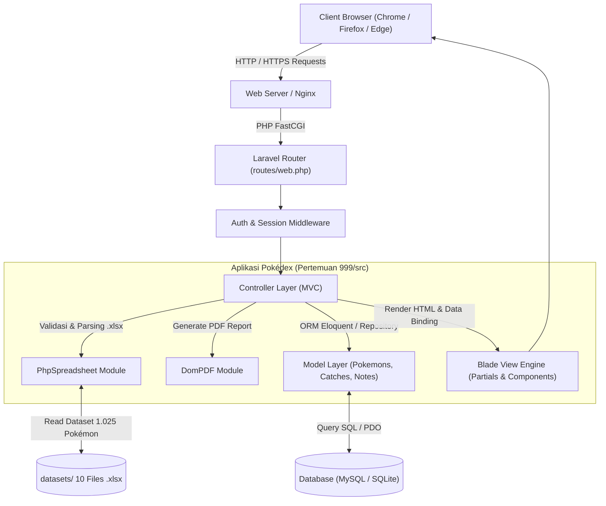
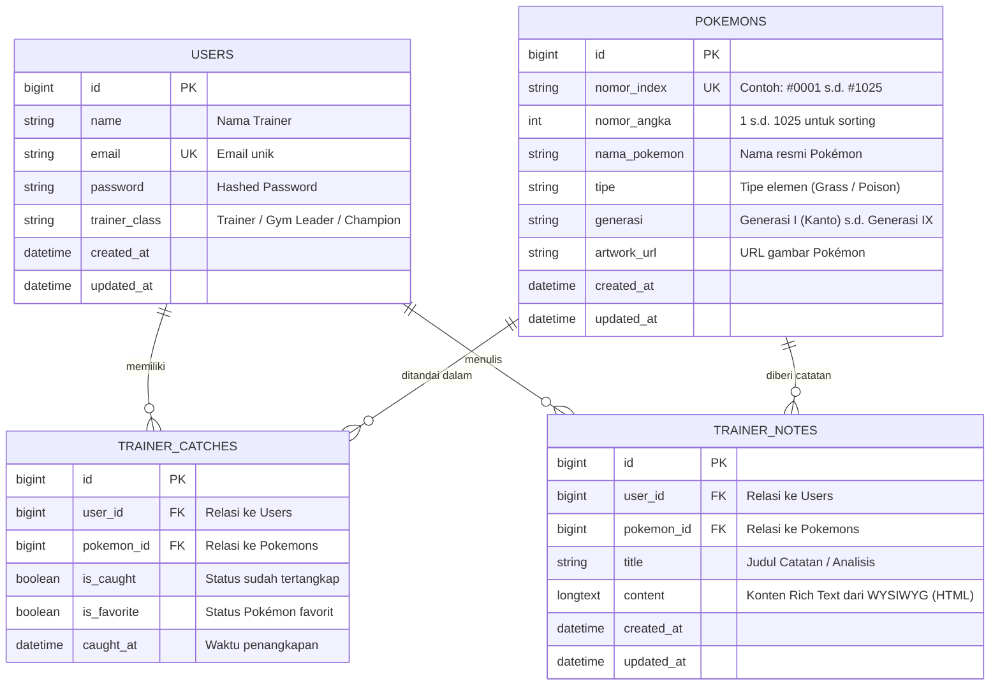

# Arsitektur Sistem: Pokédex Collection Tracker & Trainer Directory

Dokumen ini mendeskripsikan rancangan arsitektur perangkat lunak, pola desain MVC, skema basis data, aliran data (*data flow*), serta spesifikasi integrasi antarmodul untuk aplikasi **Pokédex Collection Tracker & Trainer Directory** oleh **Kelompok 13 (Kelas A / A2)**.

---

## 1. Ikhtisar Arsitektur & Teknologi (Tech Stack)

Aplikasi dibangun menggunakan arsitektur monolitik modern berbasis **Laravel Framework (PHP 8.2+)** dengan penekanan pada performa, aksesibilitas semantik, dan pengalaman pengguna (*user experience*) bertema *Tactical Dark Glassmorphism*.



### Spesifikasi Komponen Teknologi:
* **Bahasa Backend:** PHP 8.2+
* **Framework:** Laravel 11.x
* **Arsitektur Antarmuka:** HTML5 Semantik, CSS3 Modern (Custom Variables, Flexbox/Grid, Glassmorphism), Vanilla JavaScript (ES6+ Modules)
* **Pustaka Pemrosesan Data:**
  * **PhpSpreadsheet (`phpoffice/phpspreadsheet`):** Pengolahan dan validasi berkas spreadsheet Excel `.xlsx`.
  * **DataTables.net:** Penyajian data Pokédex interaktif, pagination, instant filtering, dan ekspor data sisi klien.
  * **DomPDF (`barryvdh/laravel-dompdf`):** Kompilasi laporan koleksi Pokémon format dokumen PDF.
  * **WYSIWYG Editor (Quill.js / TinyMCE):** Editor teks kaya untuk penulisan catatan jurnal dan taktik pertarungan Pokémon.
* **Basis Data:** MySQL 8.0 / SQLite 3
* **Kontrol Versi:** Git & GitLab Private Repository

---

## 2. Pola Desain MVC & Struktur Direktori

Sistem menerapkan pola **Model-View-Controller (MVC)** dengan pemisahan tanggung jawab (*separation of concerns*) yang ketat:

```
Pertemuan 999/
├── archives/               # Rekam jejak versi rilis (v1.0.0 zip, changelog)
├── datasets/               # 10 Berkas Master Excel (Gen 1-9 & All 1.025 Pokemon)
├── design-assets/          # Logo, icon, palet warna, dan wireframe UI
├── docs/                   # Dokumen arsitektur, panduan job per anggota (.docx)
└── src/                    # Source code utama aplikasi Laravel
    ├── app/
    │   ├── Http/
    │   │   ├── Controllers/
    │   │   │   ├── AuthController.php          # [Modul Yanuar] Login, register, logout
    │   │   │   ├── PokemonLibraryController.php# [Modul Arya] Master library & import Excel
    │   │   │   ├── PokedexCatchController.php  # [Modul Madina] DataTables & export PDF/Excel
    │   │   │   └── TrainerJournalController.php# [Modul Iasha] WYSIWYG notes & strategi
    │   │   └── Middleware/
    │   │       └── TrainerSession.php          # Sesi trainer aktif
    │   └── Models/
    │       ├── Pokemon.php                     # Master data Pokémon (1.025 entitas)
    │       ├── TrainerCatch.php                # Status tangkapan Pokédex per trainer
    │       └── TrainerNote.php                 # Catatan kaya WYSIWYG per Pokémon
    ├── config/
    │   └── pokedex.php                         # Konfigurasi batas kuota, metadata tipe & gen
    ├── database/
    │   ├── migrations/                         # Skema tabel database
    │   └── seeders/                            # Data awal katalog Pokémon
    ├── public/
    │   ├── css/pokedex.css                     # Gaya tactical dark glassmorphism
    │   └── js/pokedex.js                       # Logika interaktif frontend & modal
    └── resources/
        └── views/
            ├── layouts/app.blade.php           # Master layout
            └── pokedex/
                ├── index.blade.php             # Halaman utama
                └── partials/
                    ├── navbar.blade.php        # Header & info trainer
                    ├── bento.blade.php         # Kartu ringkasan progress & status
                    ├── library.blade.php       # Pokemon Library (Read-only master)
                    ├── table.blade.php         # Pokédex DataTables (Caught tracker)
                    ├── journal-modal.blade.php # Modal WYSIWYG catatan trainer
                    └── modal.blade.php         # Modal detail statistik Pokémon
```

---

## 3. Skema Basis Data & Relasi Entitas (ERD)

Aplikasi memisahkan secara tegas antara **Master Data Pokémon (Pokemon Library)** dengan **Data Koleksi Tangkapan Pemain (Pokédex Tracker)**:



---

## 4. Rincian Modul Pengembangan Tim (Kelompok 13)

### Modul 1: Autentikasi, Sesi, & Peran Trainer (Yanuar Dwi Putra)
* **Tanggung Jawab:** Mengelola alur pendaftaran trainer, autentikasi sesi login/logout, serta hak akses ke fitur Pokédex.
* **Fitur Utama:**
  * Registrasi dan autentikasi dengan enkripsi password Bcrypt.
  * Manajemen sesi aktif: informasi trainer (Nama, Kelas Trainer, Avatar/Badge) tampil otomatis di navbar atas.
  * Middleware `auth` untuk memproteksi aksi penandaan tangkapan dan penyimpanan jurnal.

### Modul 2: Arsitektur Inti & Import Master Library PhpSpreadsheet (Arya Andra Diazka)
* **Tanggung Jawab:** Membangun fondasi arsitektur sistem, manipulasi berkas spreadsheet Excel dengan `PhpSpreadsheet`, serta manajemen repositori Git dan deployment.
* **Fitur Utama:**
  * Antarmuka master katalog **Pokemon Library** (1.025 entitas, read-only).
  * Validasi cerdas format file Excel `.xlsx` (memeriksa 4 kolom wajib: `nomor_index`, `nama_pokemon`, `tipe`, `generasi`).
  * Deteksi duplikasi data, sanitasi baris kosong, dan perhitungan progress koleksi nasional (Gen I–IX).
  * Konfigurasi Git workflow, standardisasi commit, serta panduan server production.

### Modul 3: Pokédex Caught Tracker, DataTables & Multi-Format Export (Madina Dwiyana Putri)
* **Tanggung Jawab:** Membangun tabel koleksi Pokédex interaktif dengan DataTables serta fitur ekspor laporan multi-format (PDF & Excel).
* **Fitur Utama:**
  * Integrasi pustaka DataTables pada tabel **Pokédex Caught List** (hanya menampilkan Pokémon yang telah ditandai caught oleh trainer aktif).
  * Fitur pencarian instan, sorting dinamis, paginasi responsif, dan tombol cepat aksi.
  * Generator laporan dokumen PDF berstandar cetak rapi menggunakan `barryvdh/laravel-dompdf`.
  * Ekspor data tabel Pokédex ke format Excel `.xlsx` dan Print view.

### Modul 4: WYSIWYG Editor & Jurnal Catatan Taktik Trainer (Iasha Irdanti)
* **Tanggung Jawab:** Mengintegrasikan Rich Text Editor (WYSIWYG) untuk pencatatan strategi, riwayat penangkapan, dan analisis taktik Pokémon.
* **Fitur Utama:**
  * Modal editor teks kaya (Quill.js / TinyMCE) dengan toolbar styling (Bold, Italic, List, Blockquote, Image).
  * Penyimpanan catatan berformat HTML semantik ke tabel `trainer_notes`.
  * Fitur preview catatan taktik pada modal detail Pokémon.
  * Sanitasi input HTML untuk mencegah kerentanan keamanan Cross-Site Scripting (XSS).

---

## 5. Keamanan Sistem & Standar Kualitas

1. **Proteksi CSRF (Cross-Site Request Forgery):** Seluruh formulir POST (Import Excel, simpan caught, simpan catatan) diwajibkan menyertakan direktif `@csrf`.
2. **Sanitasi Konten WYSIWYG:** Konten HTML dari editor disaring dengan pustaka HTML Purifier sebelum dirender untuk mencegah injeksi script jahat.
3. **Validasi Berkas Unggahan:** Berkas impor Excel diverifikasi tipe MIME-nya (`application/vnd.openxmlformats-officedocument.spreadsheetml.sheet`) dengan batas ukuran maksimum 5 MB.
4. **Pencegahan SQL Injection:** Seluruh manipulasi basis data menggunakan Eloquent ORM dan parameter binding PDO.
